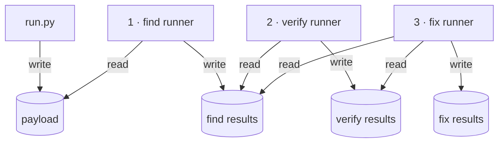
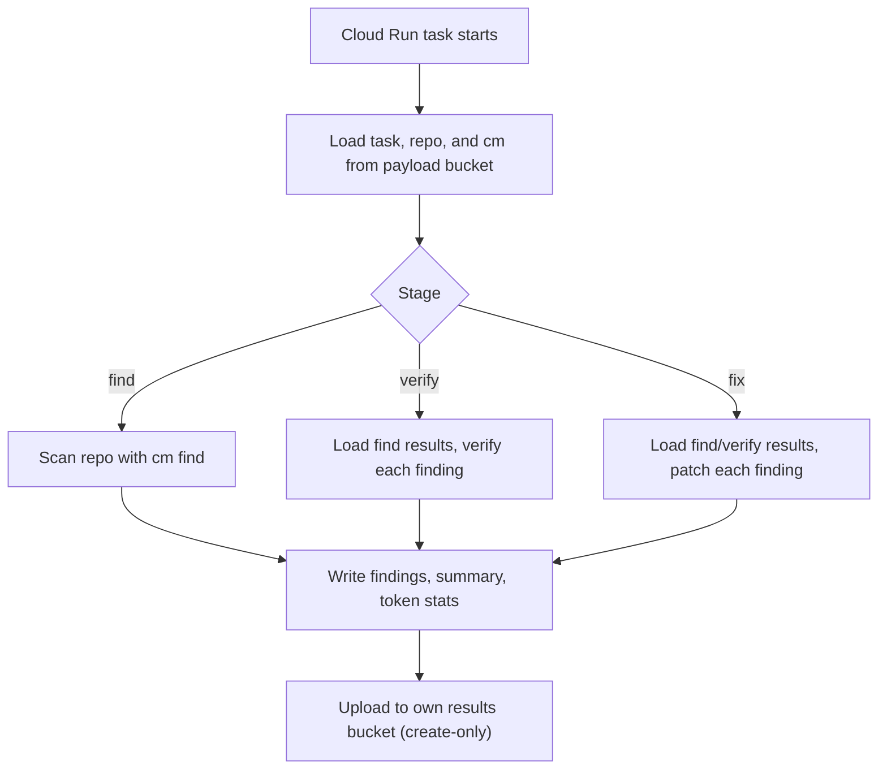
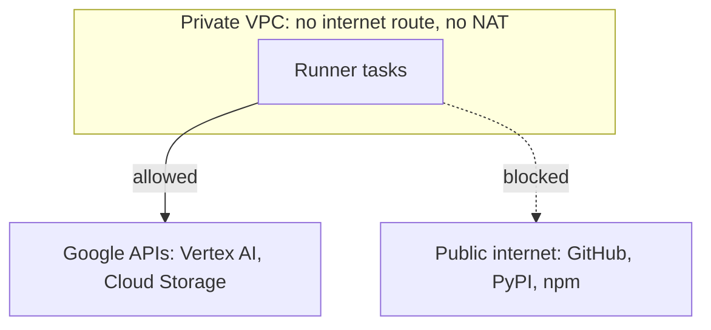
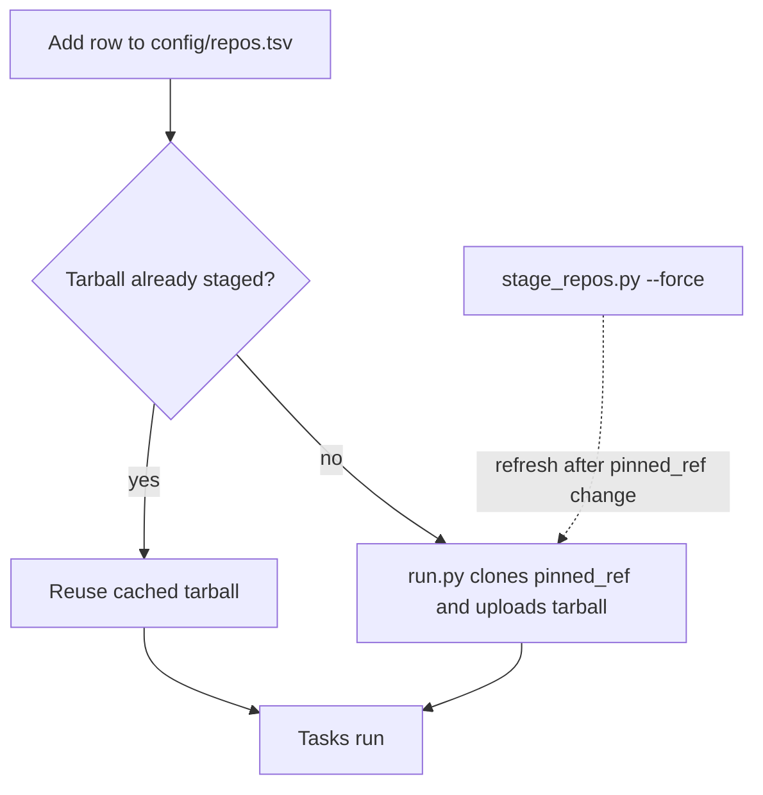

# cm-parallel-sandbox

Runs CodeMender (`cm`) `find`, `verify`, and `fix` across many repositories as parallel Cloud Run tasks in your GCP project. Each stage runs as its own service account in a VPC with no internet route, and can only create objects in its own results bucket. Every run writes findings, exploits, patches, and token usage to GCS under `<experiment_id>/<run_id>/`.

## Concepts

| Term | Meaning |
|---|---|
| task | One repo processed by one Cloud Run task. N repos = N parallel tasks. |
| stage | `find`, `verify`, or `fix`. Each is a separate Cloud Run job with its own service account and results bucket. |
| `experiment_id` | Prefix you choose to group related runs (`--experiment-id`, default `default`). |
| `run_id` | Generated per dispatch: `<YYYYMMDD_HHMMSS>_<operation>_v<cm_version>_<model>`. Later stages locate earlier results with `--from-find-run <experiment_id>/<run_id>` or `latest`. |

## Quickstart

Requires the [prerequisites](#prerequisites).

```bash
export PROJECT=<your-gcp-project>

# 1. Provision infra, build the runner image, run the isolation selftest
./terraform/bootstrap.sh --project $PROJECT --region us-central1

# 2. Run find -> verify -> fix on one small repo, one finding per stage
python3 run.py --operation find-verify-fix --repos o04-vampi \
  --experiment-id smoke --verify-limit 1 --fix-limit 1 --wait --project $PROJECT

# 3. Read the fix summary and patch (run.py prints the run_id and results path)
gcloud storage ls gs://$PROJECT-cm-fix-results/smoke/
gcloud storage cat gs://$PROJECT-cm-fix-results/smoke/<run_id>/o04-vampi/summary.json
gcloud storage cat gs://$PROJECT-cm-fix-results/smoke/<run_id>/o04-vampi/patch.diff
```

> [!WARNING]
> Omitting `--repos` runs every repo in `config/repos.tsv` (64 by default), and each task spends model tokens. Use `--dry-run` to see the task list first.

## Why use it

- **Parallel runs:** one command dispatches one Cloud Run task per repo per stage, instead of running `cm` serially on a workstation.
- **Isolation:** `verify` builds and runs exploits. It runs with no internet egress, and no stage can overwrite or delete another stage's output.
- **Tracked results:** every run records the pinned repo commit, `cm` version and SHA-256, model, flags, findings, patches, and token usage in GCS.

## Architecture

### Pipeline overview

Runners (top) read from and write to GCS buckets (bottom). Numbers show pipeline order.



`run.py` stages the repo tarballs, the `cm` binary, and `tasks.json` in the payload bucket, then executes the Cloud Run job for each stage. Chained operations (`find-verify-fix`) wait for each stage to finish before dispatching the next.

### How a runner task works



- Each task reads its entry from `tasks.json` by `CLOUD_RUN_TASK_INDEX`.
- `verify` and `fix` process findings one at a time, highest severity first, and reset the repo (`git reset --hard` + `git clean`) between findings.
- Uploads use `ifGenerationMatch=0`, so an existing object is never replaced.

### Sandbox network



- Tasks use Direct VPC egress into a VPC with the default route deleted and no Cloud NAT.
- Private DNS resolves `*.googleapis.com` to Private Google Access; the firewall denies all other egress.
- The runner image ships an offline toolbox (Python libraries, Node.js/Express, GCC/G++ with ASan, JDK, Go, PHP, Ruby) so `verify` can build exploits without network access. `pip`, `npm`, and `go` are configured for offline use.

### GCS buckets and permissions

The pipeline diagram above shows every read and write path. Each runner service account has exactly these grants:

| Runner SA | payload | find results | verify results | fix results |
|---|---|---|---|---|
| find | read | create | – | – |
| verify | read | read | create | – |
| fix | read | read | read | create |

"Create" is `roles/storage.objectCreator`: the runner can add new objects but cannot read them back, overwrite, or delete them. Tasks run with `max_retries = 0` because a retry would collide with objects the first attempt already wrote.

## Prerequisites

- A GCP project with billing and Vertex AI enabled, and quota for the model you pass to `--model`.
- `roles/owner` (or `roles/editor` + `roles/resourcemanager.projectIamAdmin`) on that project for the initial deploy.
- Read access to the `cm` release in Artifact Registry (`cmoc-prod`, repo `codemender-cli-production`). `run.py` downloads `cm` (default `0.11.0`) from there on first use.
- `gcloud` authenticated with `gcloud auth login` and `gcloud auth application-default login`.
- Terraform >= 1.5 and Python 3.9+.

## Deploy

```bash
./terraform/bootstrap.sh --project $PROJECT --region us-central1
```

`bootstrap.sh` applies `terraform/examples/dev-sandbox`, builds the runner image with Cloud Build (`deploy.sh`), and runs `scripts/selftest.sh`. It uses local Terraform state; don't point it at a project whose infrastructure is managed by another Terraform root. Manual steps, module variables, and remote state setup are in [`terraform/README.md`](terraform/README.md).

After changing anything under `container/`, rebuild the image:

```bash
./deploy.sh --project $PROJECT --region us-central1
```

## Verify isolation (selftest)

`bootstrap.sh` runs this once. Re-run it after infrastructure changes:

```bash
scripts/selftest.sh --project $PROJECT
```

It executes each job in selftest mode and prints PASS/FAIL per check:

| Group | Confirms |
|---|---|
| Network | Google APIs are reachable; GitHub and public IPs are blocked |
| Buckets | Each SA can create in its own bucket, cannot overwrite, and cannot write to the payload or upstream buckets |
| Air gap (verify/fix) | Offline compilers and runtimes work; `pip`, `npm`, and `git` can't reach the network |

## Add repos



1. Add a tab-separated row to [`config/repos.tsv`](config/repos.tsv). Only `repo_id`, `git_url`, and `pinned_ref` are read by the pipeline; the other columns are descriptive metadata.

   ```tsv
   repo_id	name	git_url	pinned_ref	language	build_system	domain	size_bucket	approx_loc	split	notes
   o04-vampi	OWASP VAmPI	https://github.com/erev0s/VAmPI.git	f16052dce83f05847133ec98f01c5193a41de7d8	python	pip	rest_api	micro	3800	OWASP	OWASP vulnerable-by-design
   ```

   `pinned_ref` accepts a tag, branch, or full commit SHA. Pin a SHA or tag so results stay reproducible.

2. Run it: `python3 run.py --repos <repo_id> ...`. `run.py` clones any repo missing from `gs://$PROJECT-cm-payload/repos/` (depth 1 at `pinned_ref`, `.git` kept) and uploads the tarball.

3. After changing `pinned_ref` for an existing repo, refresh the cached tarball:

   ```bash
   python3 stage_repos.py --repos <repo_id> --force
   ```

   `stage_repos.py` also pre-stages repos without dispatching a run.

The default set is 64 repos across 13 languages:

| Category | Count | Examples |
|---|---|---|
| Third-party open source | 55 | Flask, Django, Express.js, scikit-learn |
| OWASP and intentionally vulnerable apps | 9 | Juice Shop, WebGoat, NodeGoat, VAmPI, OWASP Benchmark (Python, Java) |

## Run

### Operations

| `--operation` | Input | Output |
|---|---|---|
| `find` | repo tarballs | findings per repo |
| `verify` | a find run (`--from-find-run`) | verification status and exploits per finding |
| `fix` | a verify run (`--from-verify-run`) or find run | patch per finding |
| `find-verify` | repo tarballs | find, then verify |
| `verify-fix` | a find run | verify, then fix verified findings |
| `find-fix` | repo tarballs | find, then fix (no verification) |
| `find-verify-fix` | repo tarballs | all three stages |

In chained operations, a failed upstream stage skips the next one and `run.py` prints the resume command.

### Common flags

| Flag | Default | Use |
|---|---|---|
| `--operation` | `find` | Stage or chain to run |
| `--repos` | all | Space-separated `repo_id`s |
| `--experiment-id` | `default` | Groups runs under one prefix |
| `--from-find-run` | none | Find run to verify or fix; `latest` picks the newest |
| `--severity` | `CRITICAL,HIGH` | Findings passed to verify and fix |
| `--verify-limit` / `--fix-limit` | `0` (all) | Max findings per repo, highest severity first |
| `--mode deep` / `--deep-workers` | `shallow` / `8` | Deep find; repos × workers must be ≤ 900 |
| `--mode diff` / `--diff-workers` | — / unset (cm's 4) | `cm find --diff=<diff_ref>` per case; needs `--repos-tsv config/repos_with_diff.tsv` |
| `--token-stats-workers` | `8` | Sessions `cm-api-token-stats` fetches concurrently per task |
| `--model` | `gemini-3.8-flash` | Model passed to `cm` |
| `--wait` | off | Block and poll every 5 minutes until the run finishes |
| `--dry-run` | off | Print the plan without changing anything in GCP |

The full list is in [docs/reference.md#flags](docs/reference.md#flags).

### Examples

```bash
# Preview a full benchmark find without dispatching
python3 run.py --operation find --experiment-id bench --dry-run --project $PROJECT

# Deep find on two repos
python3 run.py --operation find --mode deep --repos p01-flask o04-vampi \
  --experiment-id deep --project $PROJECT

# Diff find (what a PR's CI runs) on the VAmPI cases of the diff manifest
python3 run.py --operation find --mode diff --repos-tsv config/repos_with_diff.tsv \
  --repos o04-vampi--f16052d-beca461 o04-vampi--f16052d-a488a52 \
  --experiment-id cm-011-diff-smoke --project $PROJECT

# Verify and fix the latest find run, CRITICAL only
python3 run.py --operation verify-fix --from-find-run latest --severity CRITICAL \
  --experiment-id bench --project $PROJECT

# Fix one specific finding by ID prefix
python3 run.py --operation fix --from-find-run bench/<find_run_id> --repos o04-vampi \
  --finding-ids 2c72497a --project $PROJECT
```

Without `--wait`, `run.py` dispatches and exits after printing the `run_id`, results path, and `gcloud` commands to check status and logs.

## Read results

Results land in `gs://$PROJECT-cm-<stage>-results/<experiment_id>/<run_id>/<repo_id>/`:

| Stage | Key files |
|---|---|
| find | `findings.json`, `findings_table.txt`, `summary.json` |
| verify | `post_verify_report.json`, `findings/<id>/exploit/`, `summary.json` |
| fix | `patch.diff`, `findings/<id>/patch.diff`, `summary.json` |

Download a whole run:

```bash
gcloud storage cp -r gs://$PROJECT-cm-fix-results/<experiment_id>/<run_id> .
```

> [!NOTE]
> Token counts come from [`cm-api-token-stats`](https://github.com/cloud-gtm/fde-security-aigis/tree/main/cm-api-token-stats), not `cm stats`, which undercounts multi-turn and cached tokens. The runner vendors the script, scopes it to each task with `--since`, and fetches sessions concurrently (`--token-stats-workers`, default 8). Per-task totals are in `summary.json` → `tokens`; per-finding totals are in `findings/<id>/token_stats.json`.

The full layout, `summary.json` fields, and status rules are in [docs/reference.md#results-layout](docs/reference.md#results-layout).

## Limits and costs

| Limit | Value | Set by |
|---|---|---|
| Concurrent model calls (deep / diff find) | repos × `--deep-workers` (or cases × `--diff-workers`, 4 when unset) ≤ 900 | `run.py` exits 2 before staging if exceeded |
| Task timeout | 172800 s (48 h) default, 604800 s max | `--container-timeout` |
| Per-finding fix timeout | 10800 s (3 h) default | `--fix-timeout` |
| Upload reserve | 300 s per task, subtracted from the timeout | `run.py` |
| Task size | 4 vCPU, 16 GiB | Terraform `task_cpu`, `task_memory` |

Model tokens are the main cost. Check `summary.json` → `tokens` after a small run before scaling to all repos.

## Development

```bash
./scripts/check.sh
```

Runs `compileall`, the unit tests, `bash -n`, and `shellcheck` (if installed). It must pass before every commit.

`container/scripts/cm-api-token-stats` is vendored byte-for-byte from `fde-security-aigis`; don't edit it here. Re-sync steps are in [docs/reference.md](docs/reference.md#known-limitations).

## Reference

- [docs/reference.md](docs/reference.md): all flags, results layout, `summary.json` fields, exit codes, cm 0.10.0 notes, known limitations
- [terraform/README.md](terraform/README.md): module variables, manual deploy, remote state
